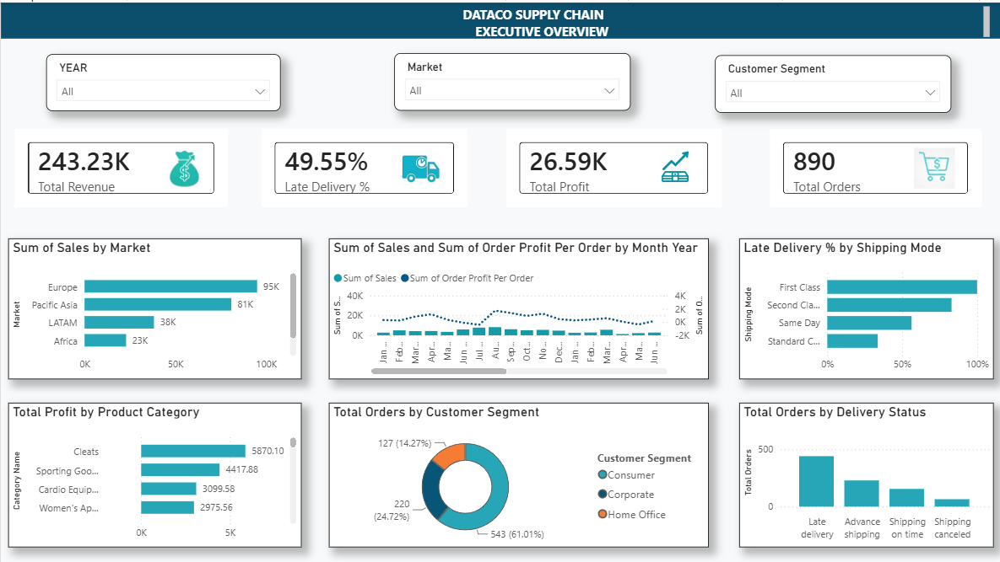
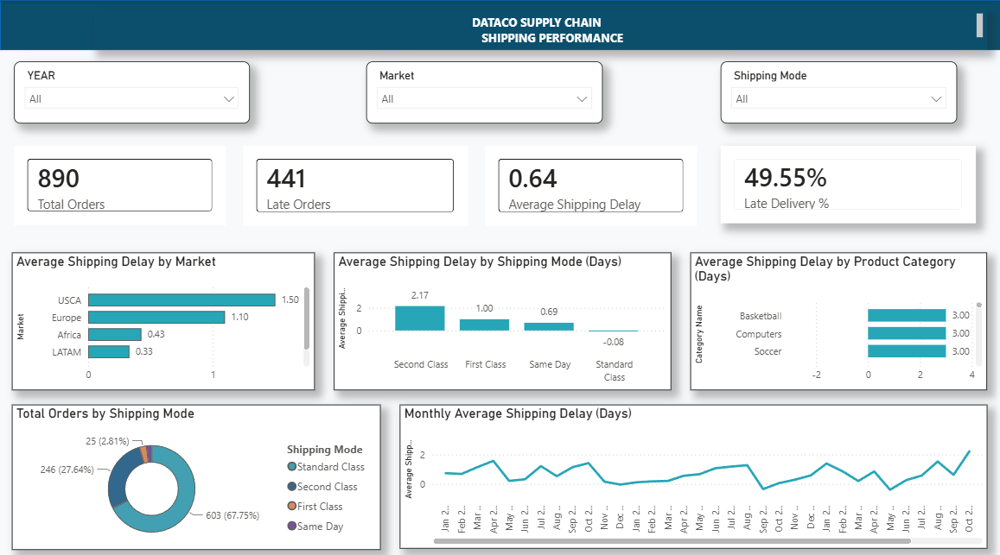
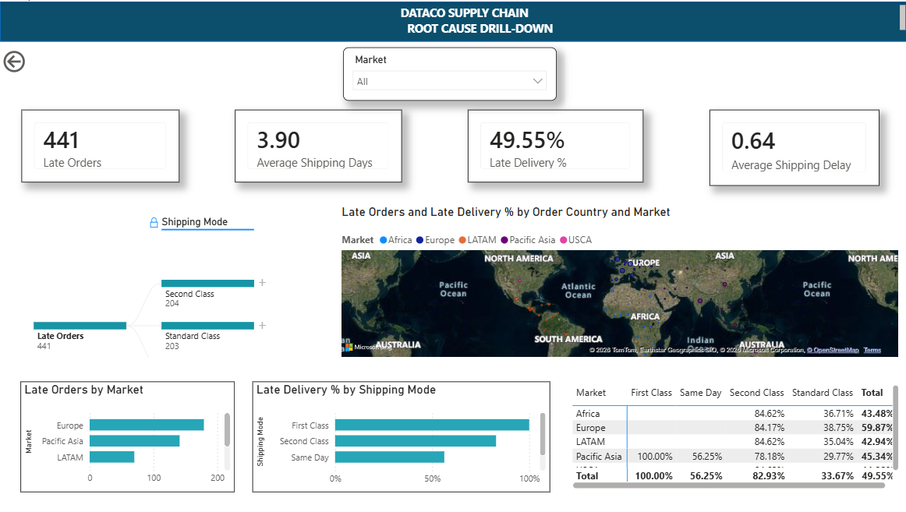

# DataCo Supply Chain Analytics

An end-to-end Data Analytics and Business Intelligence project using Python, MySQL and Power BI to analyze sales performance, profitability, shipping efficiency and delivery risks.

## Project Overview

This project analyzes the DataCo SMART Supply Chain dataset to identify business performance patterns and operational challenges.

The workflow covers data inspection, cleaning, exploratory data analysis, SQL-based business analysis and interactive Power BI dashboard development.

The project focuses on converting raw supply-chain data into meaningful insights that can support data-driven business decisions.

## Project Objectives

- Analyze sales, revenue, profit and order performance.
- Evaluate delivery reliability and late-delivery patterns.
- Compare shipping-mode performance.
- Analyze profitability across markets and product categories.
- Identify high-value customers.
- Examine monthly profitability trends.
- Investigate operational factors associated with late deliveries.
- Develop interactive business intelligence dashboards.

## Dataset

**Dataset:** DataCo SMART Supply Chain Dataset

**Dataset used in this implementation:** 999 order-item records.

The analysis was performed using a 999-row sample of the DataCo SMART Supply Chain dataset.

**Dataset availability:** The raw dataset is not included in this repository because its redistribution terms have not been verified.

To reproduce the analysis, users must obtain the dataset separately and place it inside the `01_Data_Sample/` directory using the expected filename: `Dataco_sample..xlsx`.

The complete original dataset is not included.

### Dataset Summary

| Metric                 | Value |
| ---------------------- | ----: |
| Raw records            |   999 |
| Columns after cleaning |    47 |
| Unique orders          |   890 |
| Unique customers       |   855 |
| Unique products        |    57 |
| Markets                |     5 |

## Technology Stack

| Technology   | Purpose                              |
| ------------ | ------------------------------------ |
| Python       | Data cleaning and EDA                |
| Pandas       | Data manipulation                    |
| NumPy        | Numerical operations                 |
| Matplotlib   | Data visualization                   |
| Seaborn      | Exploratory visualization            |
| MySQL 8.0    | Database management and SQL analysis |
| Power BI     | Interactive dashboards               |
| Excel        | Dataset inspection and output        |
| Git & GitHub | Version control and documentation    |

## 1. Python — Data Cleaning and EDA

Python was used to inspect, clean, validate and transform the raw dataset.

### Data Quality Checks

- Dataset structure and dimensions.
- Missing-value analysis.
- Duplicate-record checks.
- Data-type validation.
- Unique-value analysis.
- Order-level consistency checks.
- Financial calculation validation.

### Data Cleaning

The following unnecessary or sensitive columns were removed:

- Product Description
- Order Zipcode
- Customer Email
- Customer Password
- Product Image
- Customer Street

Additional transformations:

- Missing customer last names were replaced with `Unknown`.
- Order and shipping date columns were converted into datetime format.
- Financial relationships were validated.
- Order-level attributes were checked for consistency.
- Order-level aggregation was performed for delivery analysis.

### Data Validation Results

- 999 raw records inspected.
- 0 duplicate rows identified.
- 0 invalid date values.
- 0 missing values remaining after cleaning.
- Sales calculations validated against product price and quantity.
- Order profit validated against benefit per order.

The cleaned dataset and data-quality report were exported to Excel.

### Python Visualizations

Four exploratory visualizations were developed:

1. Delivery Status Distribution
2. Late Delivery Risk Distribution
3. Shipping Mode Distribution
4. Sales Distribution

## 2. MySQL — SQL Business Analysis

The cleaned dataset was imported into MySQL 8.0 using Python, SQLAlchemy and MySQL Connector.

**Database:** `dataco_supply_chain`

**Table:** `datacosupplychain_clean_sql`

Import validation confirmed that all 999 records and 47 columns were successfully loaded.

### SQL Analysis Performed

**Shipping Mode Performance**

- Distinct order counts.
- Actual late-delivery counts.
- Late-delivery percentages.

**Market Performance**

- Gross sales.
- Discount-adjusted sales.
- Total profit.
- Profit margin.

**Product Category Profitability**

- Total category profit.
- Average item profit.
- Identification of loss-making categories.

**Customer Analysis**

- Top 10 customers by discount-adjusted sales.
- Customer profit contribution.
- Distinct customer order counts.

**Monthly Profitability**

- Monthly sales.
- Monthly profit.
- Distinct monthly orders.
- Year and month analysis.

**Data Quality Validation**

- Missing-value checks.
- Duplicate order-item checks.
- Order-level consistency checks.

### SQL Concepts Demonstrated

- SELECT, WHERE and GROUP BY
- COUNT and DISTINCTCOUNT equivalents using COUNT(DISTINCT)
- SUM, AVG and ROUND
- HAVING and ORDER BY
- Common Table Expressions (CTEs)
- CASE expressions
- Date functions
- Conditional aggregation
- Data-quality validation

## 3. Power BI — Interactive Dashboard

An interactive three-page Power BI dashboard was developed using the MySQL dataset.

### Page 1 — Executive Overview

Provides a high-level summary of business performance.

**Key KPIs**

| KPI           |      Result |
| ------------- | ----------: |
| Gross Sales   | $243,231.56 |
| Total Profit  |  $26,589.09 |
| Total Orders  |         890 |
| Late Delivery |      49.55% |

**Visualizations**

- Revenue by Market
- Monthly Revenue vs Profit Trend
- Profit by Product Category
- Orders by Customer Segment
- Orders by Delivery Status

### Page 2 — Shipping Performance

Focuses on delivery efficiency and shipping performance.

**Key KPIs**

- Total Orders: 890
- Late Orders: 441
- Average Shipping Delay: 0.64 days

**Visualizations**

- Late Delivery Percentage by Shipping Mode
- Average Shipping Delay by Market
- Average Shipping Delay by Shipping Mode
- Average Shipping Delay by Product Category
- Orders by Shipping Mode
- Monthly Average Shipping Delay Trend

### Page 3 — Root Cause Drill-Down

Provides interactive analysis of delivery performance and operational risk.

**Visualizations**

- Decomposition Tree
- Late Orders by Market
- Late Delivery Percentage by Shipping Mode
- Market and Shipping Mode Performance Matrix
- Geographical Delivery-Risk Map

The decomposition tree allows further investigation of late orders across shipping modes, markets, product categories and customer segments.

## Power BI Dashboard Preview

### 1. Executive Overview



### 2. Shipping Performance



### 3. Root Cause Drill-Down



## 4. Key Business Insights

### Overall Business Performance

- The dataset contains 890 distinct orders across 999 order-item records.
- Gross sales total $243,231.56.
- Discount-adjusted sales total $218,990.36.
- Total profit is $26,589.09.
- Overall profit margin is 12.14%.

### Delivery Performance

- 441 of 890 orders experienced late delivery.
- The late-delivery rate is 49.55%.
- 229 orders had advance shipping.
- 155 orders were shipped on time.
- 65 orders were cancelled.

### Shipping Mode Analysis

| Shipping Mode  | Orders | Late Delivery |
| -------------- | -----: | ------------: |
| First Class    |     25 |       100.00% |
| Second Class   |    246 |        82.93% |
| Same Day       |     16 |        56.25% |
| Standard Class |    603 |        33.67% |

First Class has the highest late-delivery percentage in this sample, while Standard Class has the lowest.

### Market Profitability

| Market       | Total Profit | Profit Margin |
| ------------ | -----------: | ------------: |
| Europe       |   $14,464.58 |        16.83% |
| Pacific Asia |    $4,989.37 |         6.87% |
| LATAM        |    $4,496.51 |        13.05% |
| Africa       |    $1,871.26 |         9.20% |
| USCA         |      $767.37 |        13.80% |

Europe contributes the highest total profit and has the highest profit margin.

Pacific Asia has the highest order volume but a comparatively lower profit margin.

### Product Category Profitability

Four product categories recorded negative total profit in the sample. Kids' Golf Clubs had the largest category loss at $79.19.

## 5. Business Recommendations

Based on the sample analysis:

1. Investigate operational causes behind high late-delivery percentages in First Class and Second Class shipping.
2. Review delivery planning and scheduling across markets.
3. Investigate Pacific Asia's comparatively low profit margin.
4. Review loss-making product categories and their associated costs.
5. Monitor high-value customers and their profitability contribution.
6. Track monthly revenue, profitability and delivery performance.
7. Use interactive Power BI drill-downs to investigate delivery-risk patterns.

These recommendations identify areas for further investigation; the analysis does not establish causation.

## 6. Project Workflow

```text
Raw Dataset
    |
    v
Python Data Inspection
    |
    v
Data Cleaning and Validation
    |
    v
Exploratory Data Analysis
    |
    v
Cleaned Excel Dataset
    |
    v
MySQL Database Import
    |
    v
SQL Business Analysis
    |
    v
Power BI Data Modeling
    |
    v
Interactive Dashboard
    |
    v
Business Insights and Recommendations
```

## 7. Repository Structure

```text
Data_Analytics_Portfolio/
│
├── .gitignore
├── README.MD
│
├── 01_Data_Sample/
│   └── .gitkeep
│
├── 03_Python/
│   ├── end to end project.py
│   ├── load_data_to_mysql.py
│   └── output/
│       └── visualizations/
│           ├── Delivery_Status_Distribution.png
│           ├── Late_Delivery_Risk.png
│           ├── Sales_Distribution.png
│           └── Shipping_Mode_Distribution.png
│
├── 04_Visualizations/
│   ├── Delivery_status.jpeg
│   ├── Late_Delivery_risk.jpeg
│   ├── Sales_Distribution.jpeg
│   └── Shipping_mode.jpeg
│
├── 05_SQL/
│   └── dataco_supply_chain_Analysis_Improved.sql
│
├── 06_PowerBI/
│   ├── Executive_Overview/
│   │   └── Executive_Overview.png
│   ├── Shipping_Performance/
│   │   └── Shipping_Performance.png
│   └── Root_Cause_Drill_Down/
│       └── Root_Cause_Drill_Down.png
│
└── 07_Report/
    └── DataCo_Supply_Chain_Analytics_Report.pdf
```

## 8. How to Run the Project

### Requirements

- Python 3.x
- MySQL Server 8.0
- Power BI Desktop
- Required Python libraries

### Python Setup

```bash
pip install pandas numpy matplotlib seaborn openpyxl sqlalchemy mysql-connector-python
```

Run the data-cleaning script:

```bash
python "03_Python/end to end project.py"
```

### MySQL Setup

1. Start MySQL Server.
2. Create the database:

```sql
CREATE DATABASE dataco_supply_chain;
```

3. Run the Python-to-MySQL import script:

```bash
python "03_Python/load_data_to_mysql.py"
```

4. Execute the improved SQL script:

```bash
mysql -u root -p < "05_SQL/dataco_supply_chain_Analysis_Improved.sql"
```

### Power BI

1. Open `06_PowerBI/DataCo_Supply_Chain_Analytics.pbix`.
2. Connect to the MySQL database if required.
3. Refresh the dataset.
4. Explore the three interactive dashboard pages.

## 9. Project Limitations

- The current implementation uses a 999-row sample, not the complete original dataset.
- Results are descriptive and should not be generalized to the entire DataCo dataset.
- The late-delivery analysis identifies historical patterns; it is not a predictive machine-learning model.
- Shipping-delay averages are calculated at the order-item record level unless otherwise specified.
- The dataset contains incomplete monthly coverage in 2018.
- Business recommendations indicate areas for investigation and do not prove causal relationships.

## 10. Project Outcome

This project demonstrates an end-to-end Data Analyst workflow involving:

- Python-based data cleaning and validation.
- Exploratory Data Analysis.
- MySQL database management.
- SQL-based business analysis.
- Power BI data modeling and DAX.
- Interactive dashboard development.
- KPI design and validation.
- Business insight generation.
- Data-driven recommendations.

The project demonstrates how raw supply-chain data can be transformed into an analytical solution for understanding business performance, profitability and delivery efficiency.

This project is an independently extended implementation inspired by an existing DataCo analytics portfolio project.
